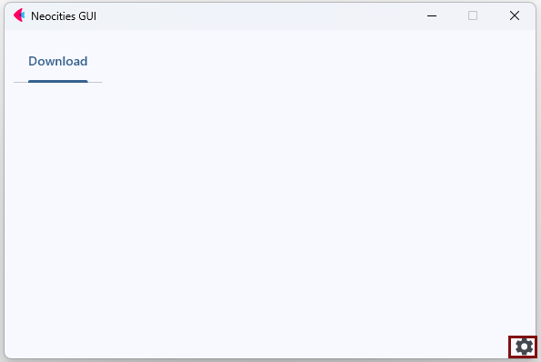
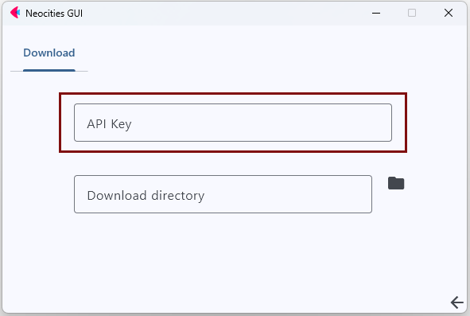
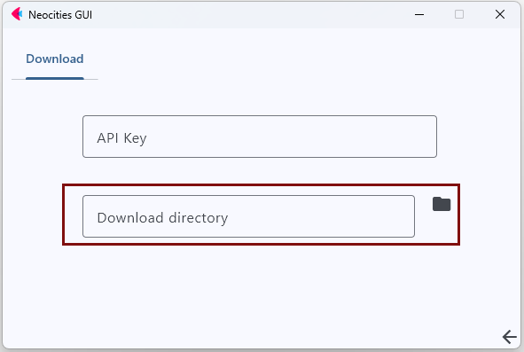
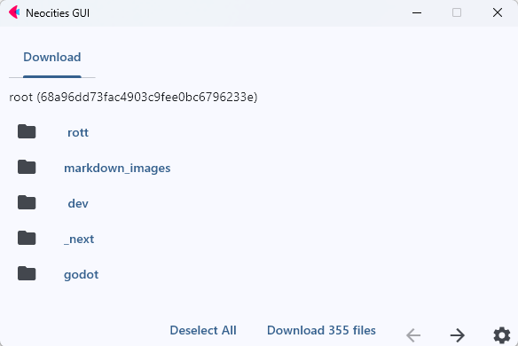
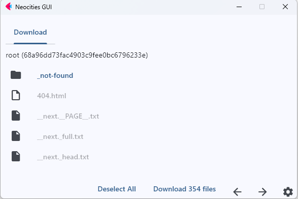
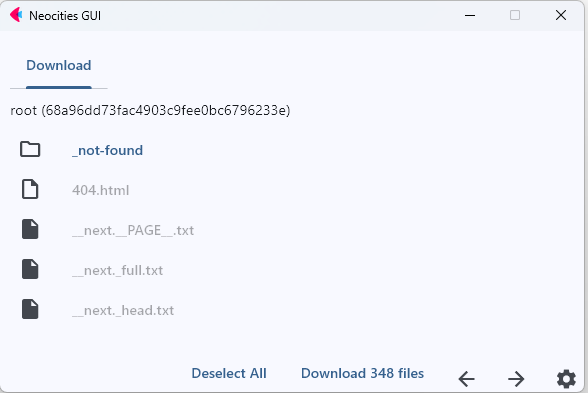
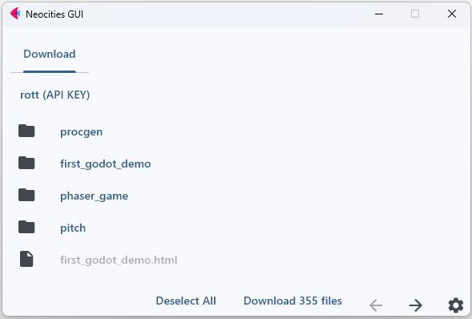
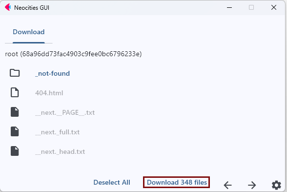
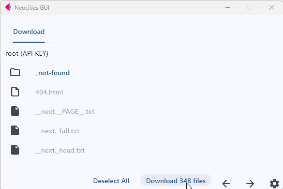

# Neocities GUI

It's a GUI for Neocities functionality that leverages its [API](https://neocities.org/api).

You'll need to set your API key in Settings:

(See [Neocities docs] for how to get it.)

## Download

To do this, you'll have to set the directory to download to.

Once you've done that, you'll see a list of all the files you can download:

You can toggle individual files

and whole directories

You can click on directories to see their contents

You always know if you're at the " root " or in a subdirectory, and which site you're working with, by the header at the top. 

If you're in a subdirectory, you can navigate back to the previous one by clicking on the header.

When you're ready to download your files, click on the download button:

(" Download.. files " tells you how many files are selected for download.)

and they'll be downloaded:

# To Be Added

- Upload